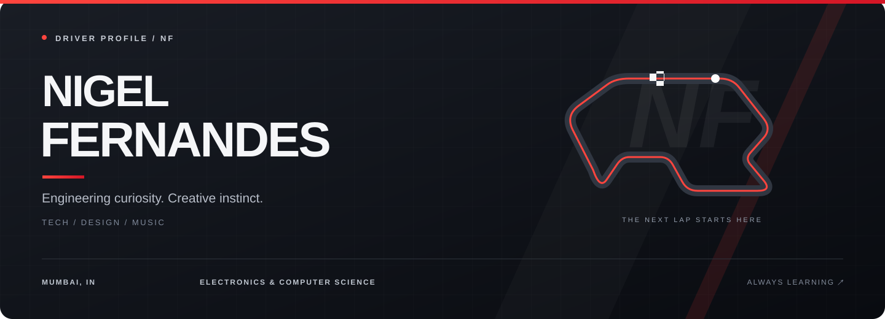

  

  <strong>ELECTRONICS & COMPUTER SCIENCE &nbsp; / &nbsp; TECH &nbsp; / &nbsp; MUSIC</strong> 
  MUMBAI, INDIA &nbsp; • &nbsp; Fr. Conceicao Rodrigues College of Engineering

  <a href="https://www.linkedin.com/in/nigelferns/">LinkedIn ↗</a>
  &nbsp;&nbsp; / &nbsp;&nbsp;
  <a href="mailto:nigelferns2211@gmail.com">Get in touch ↗</a>

---

### 01 / DRIVER PROFILE

I'm **Nigel Fernandes**, an Electronics and Computer Science student with a creative streak. My interests span technology, web design, and music production — with curiosity driving the next experiment.

I bring that same energy to technical leadership, events, and the work I create with others.

> **Engineering curiosity. Creative instinct. Always another lap to learn.**

### 02 / ON THE GRID

| Position | Current entry |
| :--- | :--- |
| **Degree** | B.Tech in Electronics and Computer Science · CRCE · 2025–2029 |
| **Team role** | Technical Representative · CRCE · Since May 2026 |
| **Interests** | Technology · Web design · Creative applications of AI |
| **Off-track** | Guitar · Music theory · Music production |

### 03 / THE TOOLKIT

**TECH & DESIGN** 
Web design · Python programming fundamentals · Generative AI foundations

**TEAM & COMMUNICATION** 
Marketing strategy · Public relations · Event management

**SOUND & CREATIVITY** 
Acoustic guitar · Music theory · Music production

### 04 / LAP NOTES

- **2026 — Stepping into technical leadership.** Technical Representative at CRCE, following event management experience with IEEExCRCE.
- **2025 — Joining the engineering grid.** Began my B.Tech in Electronics and Computer Science at CRCE.
- **2024 — Releasing “Golden Days.”** Created and released a single with friends, drawing on experimentation, AI, and independently learned music production skills.
- **2023 — A music milestone.** Achieved verified artist status on Spotify.

  
<strong>Open the garage / Learning & credentials</strong>

 

- Career Essentials in Generative AI — Microsoft and LinkedIn
- Introduction to Programming Using Python
- Hack Into PCell 2025
- Acoustic Guitar
- Music theory

**Languages:** English · Hindi · Marathi

### 05 / TEAM RADIO

Have an idea at the intersection of **technology, design, or music**? Let's connect.

**[Send a message →](mailto:nigelferns2211@gmail.com)** &nbsp; **[Meet me on LinkedIn →](https://www.linkedin.com/in/nigelferns/)**

---

  <strong>NIGEL FERNANDES</strong> &nbsp; / &nbsp; BUILT WITH CURIOSITY. TUNED THROUGH PRACTICE. 
  See you on the next lap.

