

  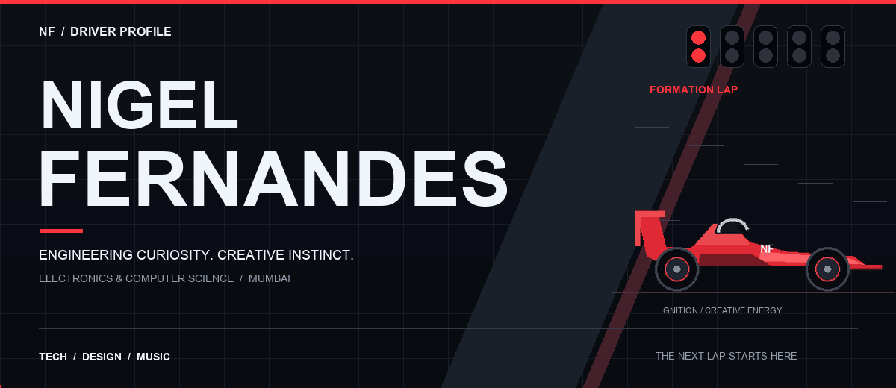

  <a href="#driver">DRIVER</a> &nbsp; / &nbsp;
  <a href="#garage">TECH GARAGE</a> &nbsp; / &nbsp;
  <a href="#projects">PROJECTS</a> &nbsp; / &nbsp;
  <a href="#laps">LAP HISTORY</a> &nbsp; / &nbsp;
  <a href="#radio">TEAM RADIO</a>

<a href="./STATIC.md">View the motion-free edition</a>

I'm **Nigel Fernandes** — an Electronics and Computer Science student at **CRCE, Mumbai**, building across web development, design, and creative technology. Off track, I make music and bring people together through events.

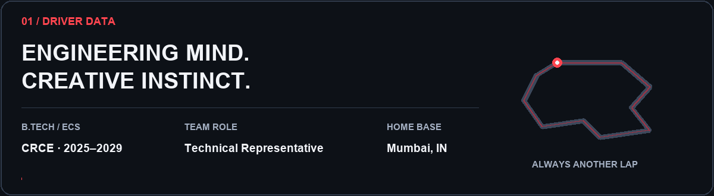

### 02 / THE TECH GARAGE

Tools from my projects and learning journey. **Tap a logo to explore.**

  <a href="https://react.dev/">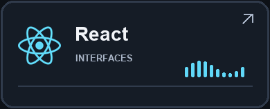</a>
  <a href="https://nextjs.org/">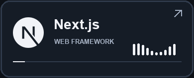</a>
  <a href="https://www.typescriptlang.org/">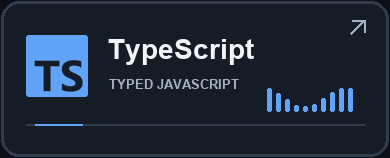</a>

  <a href="https://tailwindcss.com/">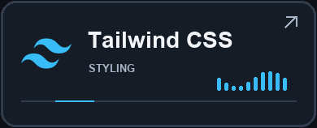</a>
  <a href="https://motion.dev/">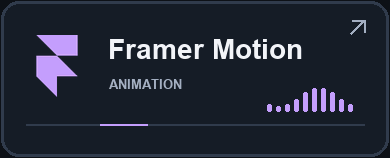</a>
  <a href="https://vite.dev/">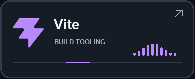</a>

  <a href="https://nodejs.org/">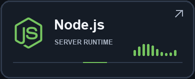</a>
  <a href="https://expressjs.com/">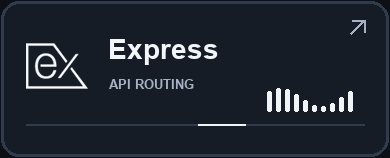</a>
  <a href="https://sqlite.org/">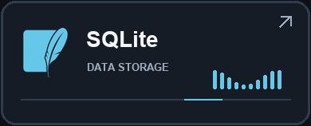</a>

  <a href="https://www.python.org/">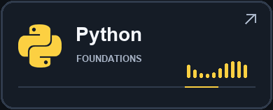</a>
  <a href="https://github.com/Nigel777123?tab=repositories">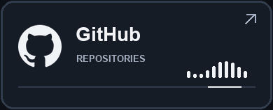</a>
  <a href="https://ai.google.dev/">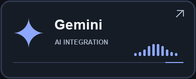</a>

<strong>Open the garage manifest — stack & credentials</strong>

- **Frontend:** React, Next.js, TypeScript, Tailwind CSS
- **Motion & tooling:** Framer Motion, Vite, GitHub
- **Backend & data:** Node.js, Express, SQLite
- **AI & learning:** Gemini integration, Python fundamentals, generative AI foundations
- **Credentials:** Career Essentials in Generative AI by Microsoft and LinkedIn; Introduction to Programming Using Python; Hack Into PCell 2025

Stack references: [portfolio](https://github.com/Nigel777123/personal-portfolio), [Campus Reconnect](https://github.com/Nigel777123/Campus_Reconnect), and [qrgpt](https://github.com/Nigel777123/qrgpt).

### 03 / THE PROJECT GRID

**Select a project to open its repository.**

  <a href="https://github.com/Nigel777123/personal-portfolio">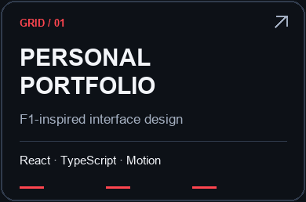</a>
  <a href="https://github.com/Nigel777123/Campus_Reconnect">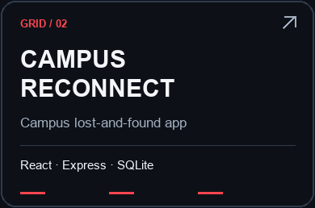</a>
  <a href="https://github.com/Nigel777123/ASL_detect">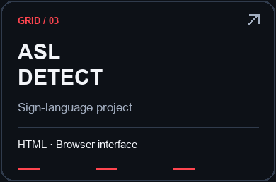</a>

<a href="https://github.com/Nigel777123?tab=repositories">Explore the full garage ↗</a>

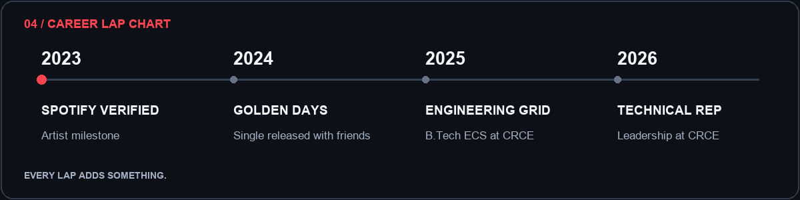

<strong>Read the race log — experience & milestones</strong>

- **2026:** Technical Representative at CRCE, following event management experience with IEEExCRCE.
- **2025:** Began B.Tech in Electronics and Computer Science at CRCE.
- **2024:** Released *Golden Days* with friends, drawing on experimentation, AI, and independently learned music production skills.
- **2023:** Achieved verified artist status on Spotify.

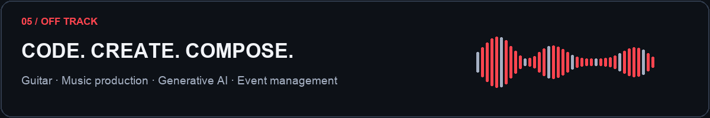

<strong>Switch to the creative channel</strong>

**Sound:** Acoustic guitar, music theory, music production. 
**People:** Marketing strategy, public relations, event management. 
**Languages:** English, Hindi, Marathi.

<a href="mailto:nigelferns2211@gmail.com">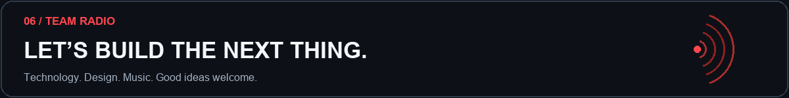</a>

  <strong><a href="mailto:nigelferns2211@gmail.com">SEND A TRANSMISSION ↗</a></strong>
  &nbsp; / &nbsp;
  <strong><a href="https://www.linkedin.com/in/nigelferns/">LINKEDIN ↗</a></strong>
  &nbsp; / &nbsp;
  <strong><a href="https://github.com/Nigel777123?tab=repositories">GITHUB ↗</a></strong>

BUILT WITH CURIOSITY. TUNED THROUGH PRACTICE. &nbsp; / &nbsp; SEE YOU ON THE NEXT LAP.

